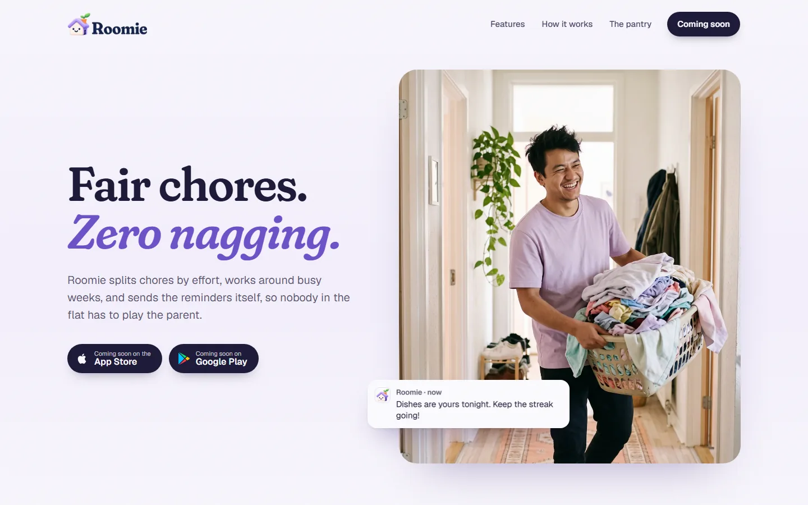
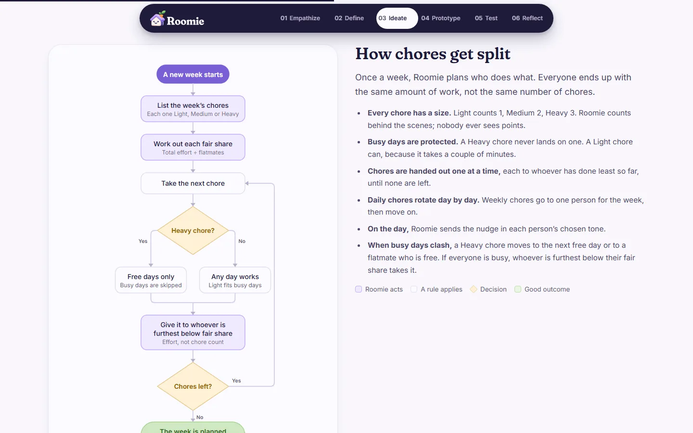
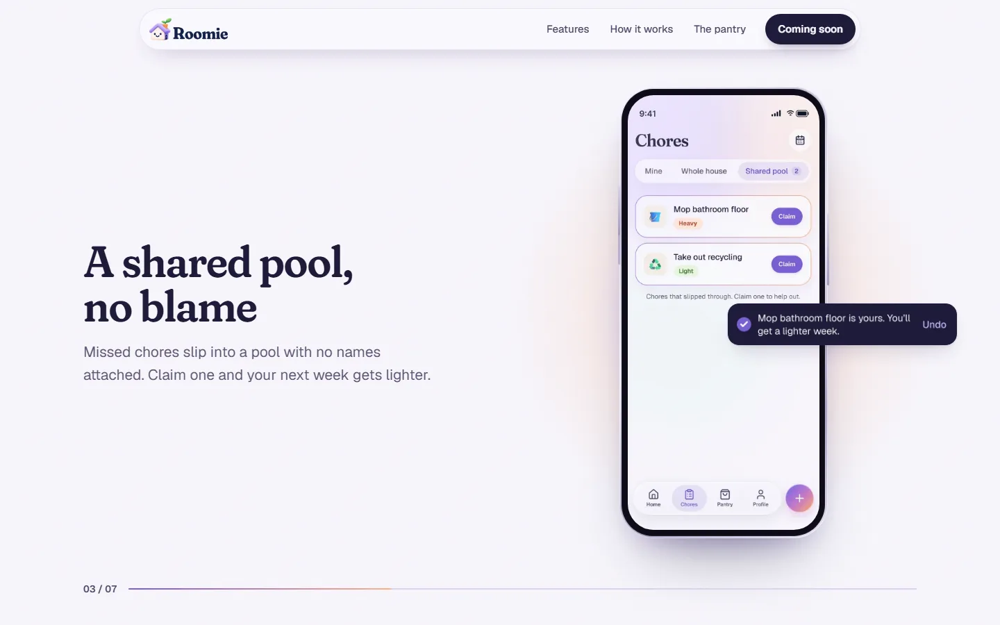
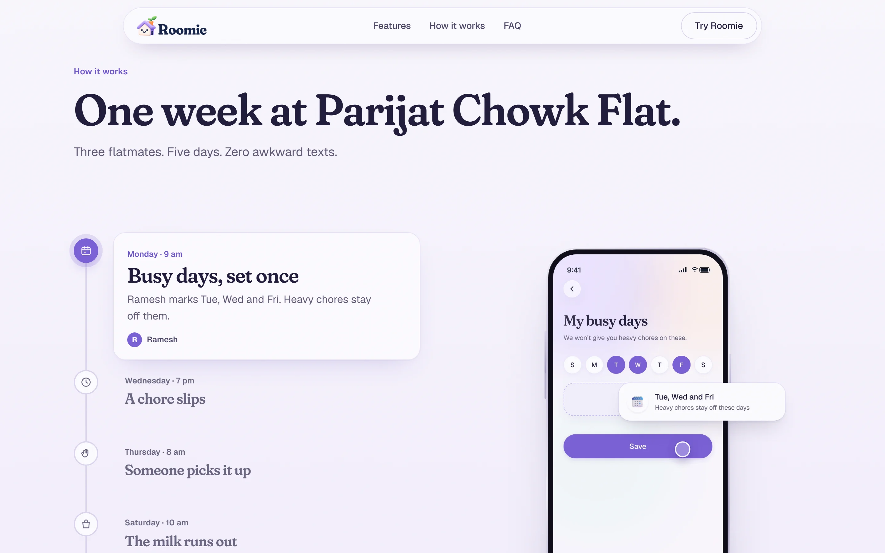
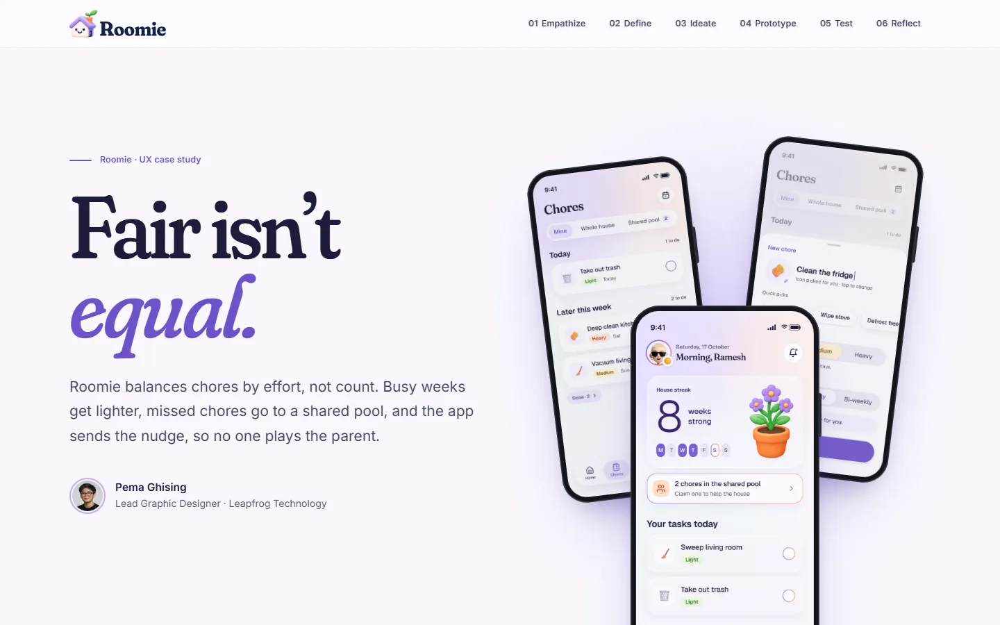

<div align="center">


### Fair chores. Zero nagging.

A household chore app that splits chores by effort, works around busy weeks,<br>and sends the reminders itself, so nobody in the flat has to play the parent.

[**Website**](https://roomie-site-sigma.vercel.app) · [**Case study**](https://roomie-case-study.vercel.app) · [**Prototype**](https://roomie-prototype.vercel.app)




</div>

## About

**Roomie is a chore splitting app for roommates, flatmates and shared houses.** It is an open UX case study and product design portfolio project by **Pema Ghising**, built with Next.js, React and GSAP. It started from one finding: in a shared flat, the chore isn't the hard part. Asking is. Roomie takes the asking away. It balances chores by effort instead of count, keeps heavy jobs off your busy days, sends missed chores to a shared pool with no name attached, and lets the whole flat grow one daily streak together.

This repository holds both public sites and the research behind them.

| | What it is | Live |
| --- | --- | --- |
| [`roomie-site`](roomie-site) | The marketing website: features, a week in a shared flat, the pantry | [roomie-site-sigma.vercel.app](https://roomie-site-sigma.vercel.app) |
| [`roomie-case-study`](roomie-case-study) | The full design-thinking case study, from research to reflection | [roomie-case-study.vercel.app](https://roomie-case-study.vercel.app) |

## How Roomie works

**Chores are split by effort.** Every chore is Light, Medium or Heavy (1, 2 and 3 behind the scenes, never shown as points). Once a week Roomie hands chores out one at a time, each to whoever is furthest below their fair share, so everyone does the same amount of work, not the same number of chores.

**Busy days are protected.** A Heavy chore never lands on a day you marked busy. Light chores can, because they take a couple of minutes.

**Missed chores never become a fight.** A missed chore moves to a shared pool that shows the chore, never who missed it. Anyone can claim it, and the helper gets a lighter load later.

**One house streak, counted in days.** A day counts when every chore due that day is done. A missed chore droops the house plant and opens a fallback window: one day for daily chores, two for weekly ones. Caught up in time, the plant recovers. If not, the streak goes back to a seed and the best run is remembered. The plant grows at 3, 7, 14 and 30 days.



## Screens

<table>
  <tr>
    <td width="50%"></td>
    <td width="50%"></td>
  </tr>
  <tr>
    <td align="center"><sub>Features tour: one feature per screen</sub></td>
    <td align="center"><sub>How it works: a week told phone by phone</sub></td>
  </tr>
  <tr>
    <td colspan="2"></td>
  </tr>
  <tr>
    <td colspan="2" align="center"><sub>The case study: Empathize, Define, Ideate, Prototype, Test, Reflect</sub></td>
  </tr>
</table>

## Run it locally

Each site is its own Next.js app. You need Node.js 20 or later.

```bash
# The marketing website
cd roomie-site
npm install
npm run dev        # http://localhost:3000

# The case study
cd roomie-case-study
npm install
npm run dev        # http://localhost:3000
```

The website ships as a static export (`npm run build` writes `out/`). Its checks run against that build:

```bash
cd roomie-site
npm run build
python tests/check_site.py
```

## Repository

```
.
├── roomie-site/          Marketing website (Next.js, GSAP, Lenis)
├── roomie-case-study/    Case study website (Next.js)
├── case-study.md         The full written case study
├── decisions-log.md      Assumptions and decisions, with the reasoning
├── evidence-map.md       Every claim mapped to its source
└── sources/              Research notes, Figma exports, style references
```

## Design

- **Type:** Fraunces for headlines, Geist for everything else, both self-hosted.
- **Colour:** lilac mist backgrounds, roof violet `#7A5FD6` for actions, lavender off-white `#FCFBFF` instead of pure white.
- **Tone:** calm, never alarmist. No points, no leaderboards, no all caps.

## Author

**Pema Ghising**, Lead Graphic Designer at Leapfrog Technology, Kathmandu.
[pemaghising.com.np](https://pemaghising.com.np)

<sub>© 2026 Pema Ghising. All rights reserved.</sub>
